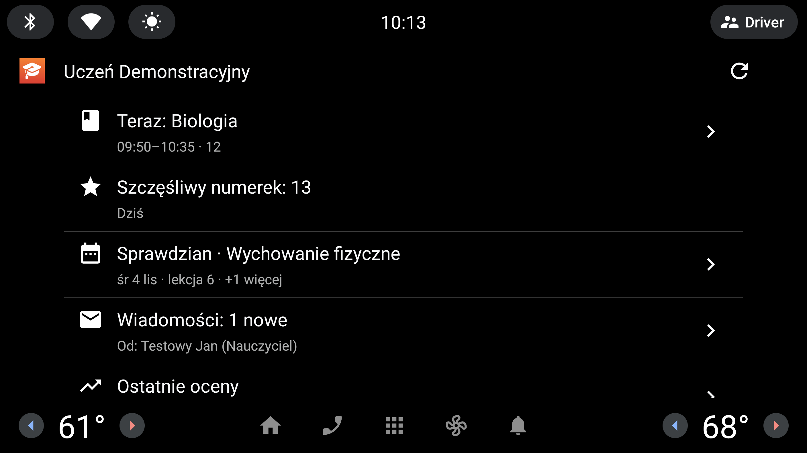
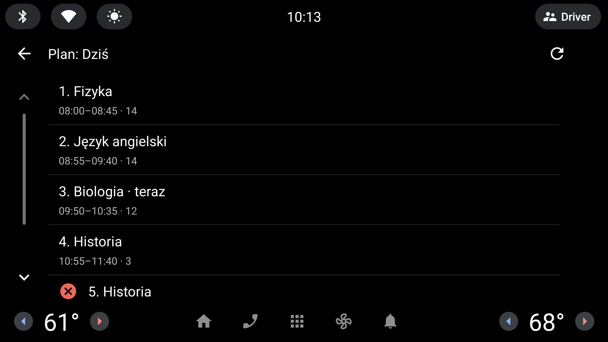
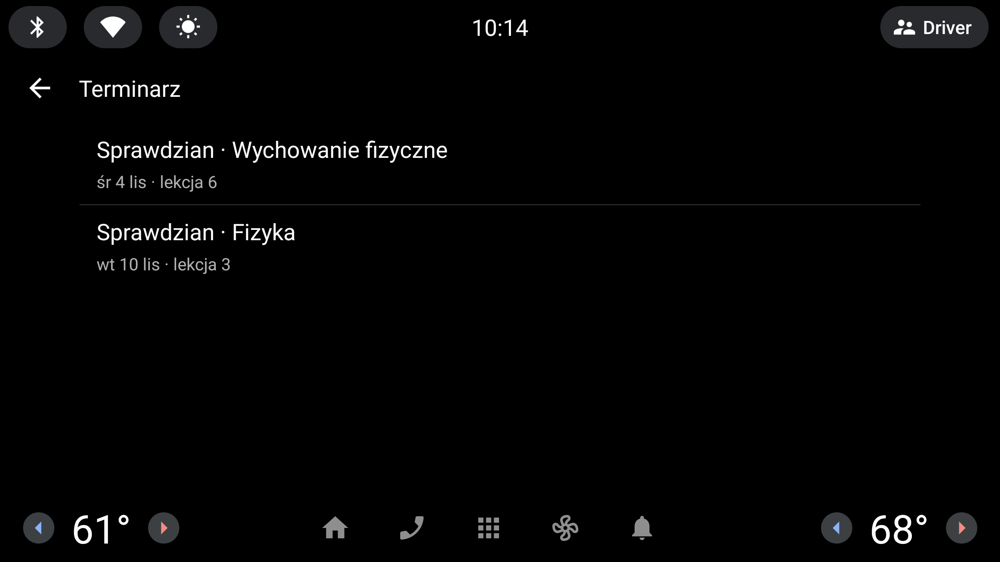
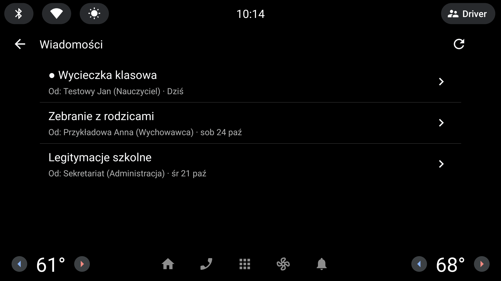
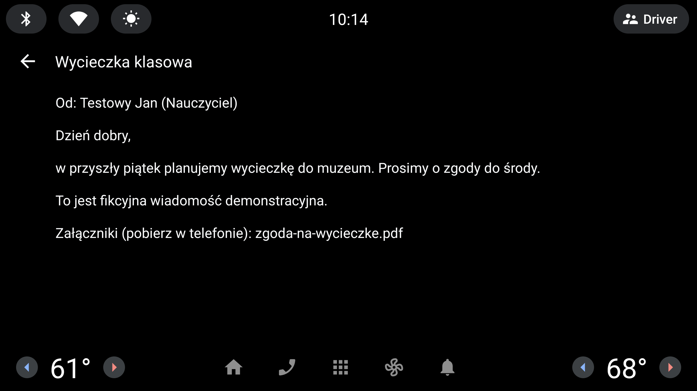
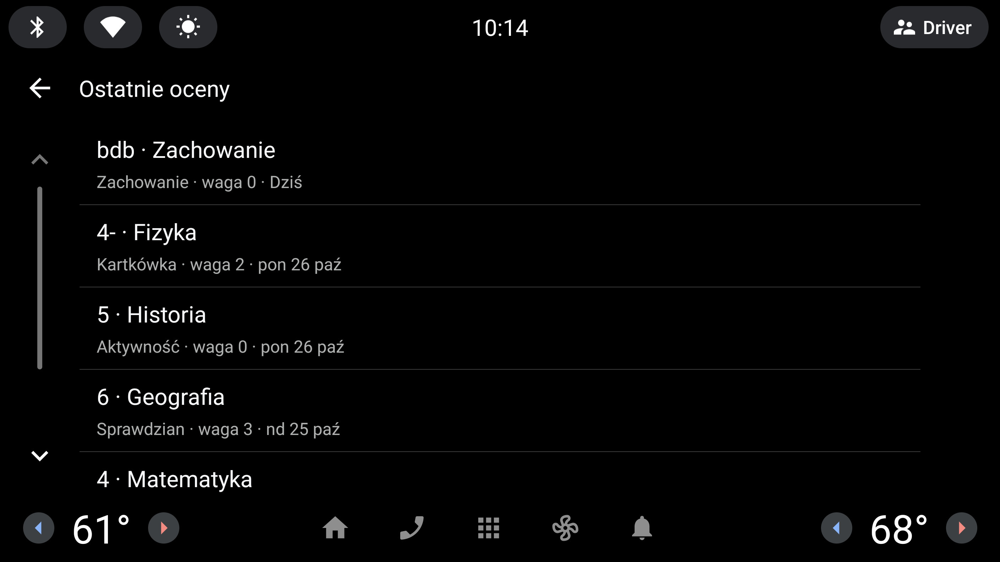
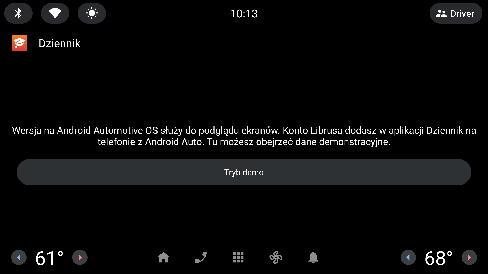

<div align="center">


# Dziennik dla Android Auto

**Nieoficjalny klient Librus Synergia na telefon z Android Auto. Port aplikacji [Szkolny.eu](https://github.com/szkolny-eu/szkolny-android)**


<br>



</div>

## Ważna informacja

Ta aplikacja **nie jest oficjalną aplikacją Librus** i nie jest powiązana z Librus Sp. z o.o., Google ani z autorami
Szkolny.eu. Korzysta z otwartego kodu [Szkolny.eu dla Androida](https://github.com/szkolny-eu/szkolny-android)
i obsługuje tylko dziennik **Librus® Synergia**.

Twórcy Szkolny.eu piszą, że **firma Librus zabroniła im** publikowania aplikacji z obsługą Librusa w Google Play.
Dlatego ta wersja **nie jest i nie będzie publikowana** w Google Play. Jest do instalacji na własnym telefonie,
do prywatnego użytku. **Może przestać działać** po zmianach po stronie Librusa.

Inne wersje: [iOS](https://github.com/wadamczewski/szkolny.eu-iOS), [CarPlay](https://github.com/wadamczewski/szkolny.eu-carplay),
[LG webOS](https://github.com/wadamczewski/szkolny.eu-webos), [Android TV](https://github.com/wadamczewski/szkolny.eu-androidtv).

> [!NOTE]
> **Stan weryfikacji.** Sprawdzone: testy na fikcyjnych danych (16/16: parsery, logowanie na lokalnym fałszywym
> serwerze, ustalanie adresata odpowiedzi, ekrany samochodowe w Robolectric) i wszystkie ekrany samochodowe na emulatorze
> Android Automotive OS 13 w trybie demo. **Nie sprawdzone:** prawdziwe Android Auto (w aucie albo w konsoli DHU),
> powiadomienia i odpowiedzi głosowe w aucie, wysyłanie odpowiedzi do prawdziwego Librusa, aplikacja na fizycznym telefonie.
> Logowanie i pobieranie danych to ten sam kod co w [Android TV](https://github.com/wadamczewski/szkolny.eu-androidtv),
> a wiadomości odczytuje ten sam parser HTML5 co w działającej wersji iOS.

## Co robi w aucie

Android Auto wpuszcza aplikacje tylko z kilku kategorii. Dziennik korzysta z dwóch dróg:

**1. Wiadomości z Librusa czytane na głos.** Telefon co ok. 30 minut sprawdza skrzynkę. Nowa wiadomość pojawia się
w aucie jak SMS, a Asystent czyta nadawcę i temat. Możesz:
- **odpowiedzieć głosem.** Asystent odczyta odpowiedź i zapyta o potwierdzenie. Odpowiedź trafia do nadawcy w Librusie,
  a adresata aplikacja znajduje na liście odbiorców Synergii tak jak wersja iOS. Jeśli go nie znajdzie, nic nie wysyła
  i pokazuje informację, żeby odpowiedzieć w telefonie.
- **oznaczyć jako przeczytaną.** Wtedy otwiera wiadomość na Synergii, co ustawia ją jako przeczytaną.

W powiadomieniu jest tylko temat. Treść nie jest pobierana w tle, bo samo pobranie oznaczyłoby wiadomość jako przeczytaną
(nauczyciel to widzi).

**2. Ekran „Dziś” w aplikacjach auta** (szablony Car App Library):
- trwająca albo następna lekcja, a po kliknięciu plan dnia z zastępstwami i odwołaniami
- szczęśliwy numerek
- najbliższy sprawdzian lub wydarzenie i cały terminarz na 2 tygodnie
- wiadomości (lista; treść wyświetla się tylko na postoju)
- ostatnie oceny
- kilku uczniów: przycisk „Uczeń” przełącza między nimi

Android Auto pokazuje ekrany aplikacji spoza Google Play tylko po włączeniu **Nieznanych źródeł** (niżej).

## Zrzuty ekranu

Zrzuty z **emulatora Android Automotive OS 13** (system wbudowany w auta z Google), w rozdzielczości 2816×1584
(układ ekranu 1408×792 w dwukrotnej gęstości), w trybie demonstracyjnym. **Wszystkie dane na zrzutach są fikcyjne.**
To te same szablony Car App Library, które wyświetla Android Auto. Android Auto rysuje je jednak we własnym stylu
(kolory, czcionki, pasek boczny), więc w aucie z Android Auto wyglądają nieco inaczej. Kliknij obrazek, żeby zobaczyć
pełną rozdzielczość.

<table>
<tr><td width="50%"><a href="screenshots/01-dzis.png"></a><br><sub>Dziś: trwająca lekcja, numerek, terminarz, wiadomości</sub></td><td width="50%"><a href="screenshots/02-plan.png"></a><br><sub>Plan dnia z bieżącą i odwołaną lekcją</sub></td></tr>
<tr><td width="50%"><a href="screenshots/03-terminarz.png"></a><br><sub>Terminarz na 2 tygodnie</sub></td><td width="50%"><a href="screenshots/04-wiadomosci.png"></a><br><sub>Wiadomości (● nieprzeczytana)</sub></td></tr>
<tr><td width="50%"><a href="screenshots/05-wiadomosc.png"></a><br><sub>Treść wiadomości (tylko na postoju)</sub></td><td width="50%"><a href="screenshots/06-oceny.png"></a><br><sub>Ostatnie oceny</sub></td></tr>
<tr><td width="50%"><a href="screenshots/07-logowanie.png"></a><br><sub>Pierwsze uruchomienie (wersja Automotive OS)</sub></td><td></td></tr>
</table>

## Instalacja

1. Zbuduj APK (niżej) i zainstaluj go na telefonie z Androidem 8+:

   ```bash
   adb install -r app/build/outputs/apk/mobile/release/app-mobile-release.apk
   ```

2. Otwórz **Dziennik** na telefonie i zaloguj się **loginem i hasłem Synergii** (np. `1234567u`). Logowanie Kontem
   Librus (e-mail) nie jest obsługiwane. W karcie **Android Auto** zezwól na powiadomienia i wyślij powiadomienie testowe.
3. Włącz **Nieznane źródła** w Android Auto: otwórz jego ustawienia (zwykle **Ustawienia → Połączone urządzenia →
   Ustawienia połączeń → Android Auto**), stuknij 10× **Wersja** na dole, potem **menu ⋮ → Ustawienia programisty →
   Nieznane źródła**.
4. Podłącz telefon do auta. Dziennik pojawi się w menu aplikacji Android Auto, a nowe wiadomości będą odczytywane.

APK jest podpisany kluczem debug, co wystarcza do prywatnej instalacji.

## Kompilacja

Potrzebny jest **JDK 17** i Android SDK (zmienna `ANDROID_HOME` albo plik `local.properties` z `sdk.dir=…`).

```bash
./gradlew assembleMobileRelease
```

Testy (dane fikcyjne):

```bash
./gradlew testMobileDebugUnitTest
```

Wariant **automotive** (`./gradlew assembleAutomotiveDebug`) uruchamia te same ekrany na Android Automotive OS.
Służy do podglądu na emulatorze, bo konto dodaje się w aplikacji na telefonie, a tu jest tylko tryb demo.
Zrzuty z README odtworzysz skryptem `./tools/screenshots-automotive.sh` na emulatorze Automotive OS 13
(`automotive_1408p_landscape_with_google_apis`, w `config.ini` 2816×1584 i gęstość 320, zegar emulatora 10:05).

<details>
<summary>Struktura projektu</summary>

```
app/src/main/java/pl/prywatny/dziennik/auto/
  librus/      logowanie Synergii, API gateway, parsery, wiadomości i odpowiedzi (Kotlin, OkHttp, Jsoup)
  data/        konta (szyfrowane kluczem Android Keystore), pamięć podręczna, przeczytane wiadomości
  car/         ekrany samochodowe (Car App Library): Dziś, plan, terminarz, wiadomości, oceny
  messages/    powiadomienia MessagingStyle, sprawdzanie skrzynki (WorkManager), odpowiedź i „przeczytane”
  AppGraph.kt  wspólne dane dla telefonu, auta i zadań w tle; Today.kt: logika „co teraz”
app/src/mobile/      aplikacja na telefon (Material 3) i deklaracja dla Android Auto
app/src/automotive/  wariant Android Automotive OS
app/src/test/        testy jednostkowe
fixtures/            fikcyjne odpowiedzi Librusa używane w testach
tools/               screenshots-automotive.sh
```

</details>

## Prywatność i bezpieczeństwo

- Aplikacja łączy się wyłącznie z `*.librus.pl`, nie z serwerami Szkolny.eu ani z innymi.
- **Hasło Synergii jest zapisywane**, bo bez niego nie da się odnowić sesji. Lista kont jest szyfrowana kluczem AES
  z Android Keystore. Kopie zapasowe aplikacji są wyłączone.
- Co ok. 30 minut aplikacja w tle pobiera listę wiadomości (sam nagłówek, bez otwierania treści).
- Temat i nadawca wiadomości pojawiają się na ekranie auta i są czytane na głos. Weź to pod uwagę, jeśli jeździsz
  z pasażerami. Powiadomienia wyłączysz w aplikacji jednym przełącznikiem.
- **Odpowiedź z auta naprawdę wysyła wiadomość** w Librusie do nadawcy. Asystent prosi o potwierdzenie przed wysłaniem.
- **Usuń ucznia z telefonu** (menu ⋮) kasuje login, hasło i pobrane dane.
- Dane w `fixtures/` i w trybie demo są fikcyjne. **Nie wklejaj w zgłoszeniach danych logowania ani prawdziwych danych uczniów.**

## Gdy coś nie działa

- **Dziennika nie ma w menu aplikacji w aucie:** włącz Nieznane źródła w ustawieniach programisty Android Auto
  i podłącz telefon ponownie.
- **Brak powiadomień w aucie:** sprawdź zgodę na powiadomienia i przełącznik w karcie Android Auto. Pierwsze sprawdzenie
  tylko zapamiętuje obecne wiadomości, a powiadomienia przychodzą dla kolejnych.
- **„Nie znaleziono adresata”:** nadawcy nie ma na liście odbiorców Synergii pod tą samą nazwą. Odpowiedz w telefonie.
- Logowanie i parsery: `librus/Session.kt` i `librus/Synergia.kt`.

## Licencja

Dziennik, tak jak Szkolny.eu, jest publikowany na licencji [GNU GPLv3](LICENSE). Możesz modyfikować kod i dystrybuować
zbudowane wersje razem z kodem źródłowym, nie możesz zmieniać licencji ani informacji o prawach autorskich.
Za opracowanie komunikacji z Librusem odpowiadają autorzy [Szkolny.eu](https://github.com/szkolny-eu/szkolny-android).

Nazwy Librus®, Android Auto™ i Android Automotive™ są znakami towarowymi ich właścicieli. Używamy ich wyłącznie w celu
wskazania, z czym współpracuje aplikacja.

*Kod został przygotowany z pomocą AI. Przejrzyj go przed użyciem.*
